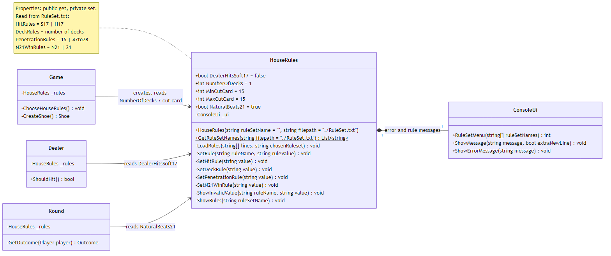

# Title: Kunskapskontroll 3 - Individual report - BlackJack feat. House-rules

#### **Creator:**       Arne Hagman
#### **Group:**         2
#### **Date:**          22Oct2026
#### **Program:**       MAI26MA
#### **Course:**        Module II - Programmering och objektorienterad utveckling i C-sharp
#### **Assignment:**    Kunskapskontroll 3 - Tjugoett (Blackjack) - Individual Feature **House-Rules**

#### **Description:**   Single or multiplayer computer game that follow international Blackjack rules

##  Introduction

### Aim 

In this group-assignment, students were tasked to collaborate on a project to develop a classic Swedish card game "Tjugoett", equivalent to the international casino game Blackjack.  

One goal of the project was to have a prototype (or a MVP) with the basic functionality within 4 working days, and to add individual features ready to present within 7 working days. The individual feature that I chose was to implement different house-rules to the game. Two other features that other group members implemented were (I) enhanced graphics, and (II) increased deck-numbers (shoe) and a card-counting tool to assist the player. This report will mainly focus on my feature, the house-rules. Please refer to the individual reports of other members of group 2 for detailed information on the other features. 

Another goal (apart from writing the program) was for the students to practise working in groups and to experience group-dynamics when working towards a common goal within a limited time-frame. And as a final outcome, to learn from the whole process through individual reflection and analysis.

### Main Tasks
1. Develop a game "tjugoett" (BlackJack) that follow a predefined set of hardcoded and basic rules (according to the instructions: https://mai26ma-ha.lms.nodehill.se/uploads/documents/2026-09-23T19-55-46/MAI26-kunskapskontroll-3-tjugoett.pdf). In short, the task was to develop a game that allow player(s) to play a card game against the computer (the house, represented as the card-dealer). Both player(s) and dealer collect cards and try to achieve the total value of 21, or to be as close to it as possible without exceeding it. All within the framework of preset House-rules.
2. Work in a group towards a common goal while keeping the deadline, by following a framework for a methodology (i.e. Agile/SCRUM). In short, the start-up phase was initiated with a process similar to a backlogg (defintion of User stories - and tasks), and then the follow-through-phase similar to a sprint that was monitored with meetings (Scrums).
3. Collaborate with other developers that work on parallel feature-branches, using Git and GitHub. Experience and learn good S.O.P's approaches for more streamlined collaborative work,while maintaining the integrity of i.e. the common Dev-branch that is at the final stage, merged with Main.
4. Practise on setting up a project in github, on making pull requests (PR) and to review the code of others (pull requests) prior to merging into dev, while maintaining the integrity of the dev-branch

### Main Program Components, and feature House-rules

**Menu-system:**
Upon starting the computer program (i.e. using bash command: dotnet run), the player will see a menu where the player(s) can choose to:\
(I) Lägg till spelare/add new player\
(II) Ta bort spelare/remove a player\
(III) Visa Spelarstatistik/show historical player statistics\
(IV) Börja spela/start a new game, and\
(V) Avsluta spelet/Exit game.

Upon chosing option (IV), a submenu will appear on the console. Here the player(s) will be able to chose the different settings, or house-rules for the game. 

**House-rules:**
Two common house-rules that are used in the casino have been added as predefined options. The House-rule feature was designed to allow for addition of new rules, either by adding predefined sets, or by individually tweaking the rules. In other words, players can add additional house rules by following the same format as the preset rules, or to create their own set of hybrid rules, by providing different combination of specific rules. Leaving null will  revert to the default and standard houserule (option 1). A more detailed description of the House-rules, with my own personal reflection and motivation for the design choice, with examples of obstacles and how they were overcome will be discussed throughout the main text below. 

**Game-flow:** 
Player(s) will play a game against the dealer (computer). One game consist of rounds two rounds. In the first round, all players starts with 2 open cards, and the dealer starts with one open, and one closed (hole) card. The player(s) look at all open cards and makes a decision on how to proceed their game. In the second round round each player(s) can choose to hit (add a new open card to the hand) or stand (stop) with current cards in the hand. After the second round, the dealer will reweal his hole card, and either hit or stand (by adhering to the House-rules as specified below). In the following rounds, the remaning players (the ones who did not choose to stand) will either hit or stand trying to reach as close as possible to the total sum of 21, without exceeding it. The game follow simple basic rules (either hardcoded) or dynamic (House-rules) such as:

**overview: House-rules (Feat. 23)**\
Hardcoded:

1) Ace is worth 1 (hard hand) or 11 (soft hand). The default value is 11, but only if the total sum of all cards would exceed 21, the value will be 1 
2) Suit cards are worth 10 points
3) All other cards 2-10 are worth their corresponding values
4) Natural Blackjack (Ace + Suit, or 11 + 10) is the highest achievable hand
5) Closest hand to 21 always wins

Dynamic:

5) Dealer rule: i.e. always stand on soft 17, or hard 17
6) Deck size rule: i.e. A shoe (container of cards) can consist of 1 or more decks, up to 8 
7) Playable cards in game: i.e. A Cut-card divides the cards into a percentage of playable, and non-playable cards. Thus, its main function is to prevent the shoe from running out of cards and in the middle of a game. It also act as means to regulate or prevent counting cards. This percentage will vary depending on the strictness level
8) Win conditions: If Blackjack always wins, or i.e. draw against 21 with more than 2 cards - depends on the house-rules

**Additional features:** Apart from the dynamic House-rule settings, the game contains 2 additional enhancements to improve game aesthetic/playability and user experiences; (I) improved graphics, and (II) card-counting tools to help a player in their decisions. All additional features add extra flavour to the game, and enhances the user experience and game aesthetics. For more detailed information on the other reatures, please refer to the individual reports of other members of group 2. 

## Results and Discussion
The Feature that I implemented was the House-rules. A HouseRule class was created for the sole purpose to read preset rules from a file (at the choise of the user), and to give access to the rules where they were once hard-coded in the classes (I) game - upon creation of a new game (II) Shoe - upon creation of new deck(s) of cards, (III) Dealer - upon creation of a Dealer, and (IV) Round - upon initiatio of new rounds. All these classes were once hardcoded with standard rules. By implementing the HouseRule class, the game was upgraded to contain a new feature, to allow a user/player access more Casino rules to chose from.

Figur 1 show the design of the HouseRules class. The class has public get and -private set properties that allow the HouseRule object to set its own hidden fields that store the rules. These are (I) if dealer hits on soft 17, or hard 17, (II) number of decks (III) minimum cut card (IV) maximum cut card and (V) if natural 21 always 21 with 3 or more cards. When deciding between a static or an instantiable HouseRule class, I made the choise to use the latter options due to some advantages. 

For example, when instatiated (i.e. by Game, when a new game starts), the constructor will try to initiate reading a file (RuleSet.txt) that contain set of rules. If the file does not exist, a FileNotFoundException will be caught, and the rules will fallback to the preset standard rule values that are already stored in the hidden field. This design was chosen to be able to have a preset values to fall-back to, in case there is no file, or if the file is corrupt and rules cant be read, instead of a game-crash. The design to read rules from a file, also allow the creation of new set of rules, or even hybrid rules. For instance, the RuleSet.txt can be edited to contain additional set of House-rules that follow the allowed format, or a combination of the different House-rules. 

The choice to use public getters allow the rules to be accessable where they are needed. Apart from when the game starts, and the creation of a new shoe (i.e. number of decks, or cut card intervalls), or at the instantiation of the dealer object (i.e to set the rule if it should always hit on i.e. soft 17 or not), or when the round is instantiated to set the winning conditions (if natural 21 always wins or not etc..). 

The HouseRule does not contain any direct communication with the user (according to the instructions for rule-classes). All error and rule messages are called from ConsoleUi.

Figure 1. HouseRules class. This figure show how the Feature House-rules was implemented with the HouseRule class. An overview of the properties and hidden field values, functions, and where the hardcoded rules were accessed by this class to set new rules prior the start of a new game, and the ConsoleUI functions it calls to interact with a user.

There were several difficulties with this project. Apart from the strict deadline, there were some struggles with the code. One example is how to distinguis soft-hand from hard-hands. Initially I calculated only soft-hand, based on 1 ace and total sum below 21. After searching for alternative solutions on the internet, I found a solution to count only hard cards (including ace(s)) first (refer to the Hand class for the formula).

Apart from working with the code I also learned insightful lessons from working in a group, towards a goal, under time-pressure, to follow S.O.P, how to maintain the integrity of a Dev branch etc. (see goal sections above). I also learned how important it is to really plan a project well from start, i.e. how better prioritize the different tasks, and how to better divide the tasks before starting to work on a first-come- first serve basis. These are insights that I will bring to the next project, and where I would like to try some new approaches on better structuring the work, and designation of tasks before starting the work.